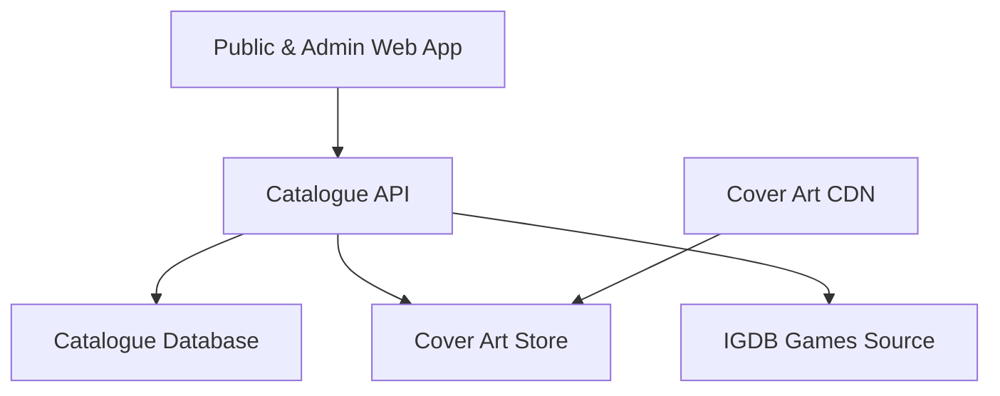
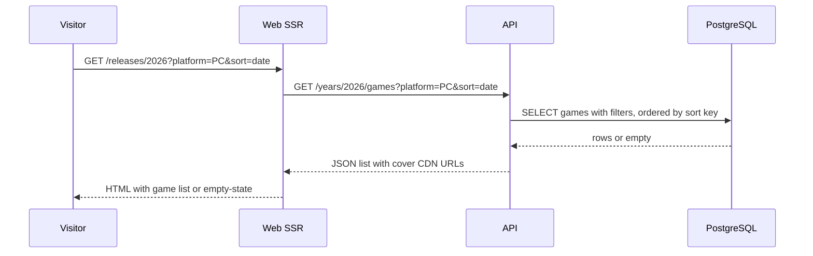
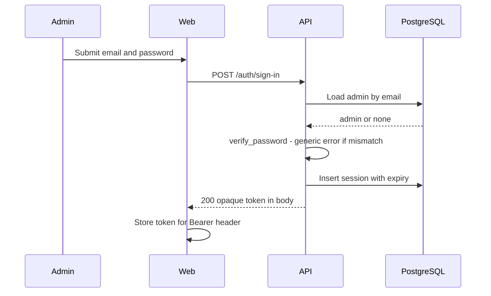
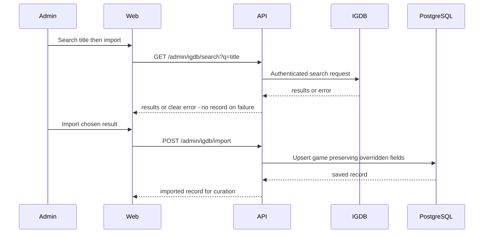
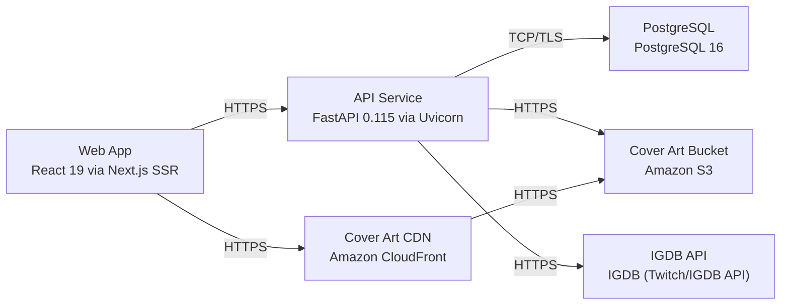

# Architecture

> Maintained by QuorQ AI SDLC. Text between `sdlc:auto` markers is regenerated; anything outside them is yours and is kept.

<!-- sdlc:auto:start narrative -->
## Overview

### ARCH-OVERVIEW · approved · source: architecture:summary

Atrocity is architected as a public, read-heavy, SEO-friendly tracker of annual AAA game releases with per-year roundup pages, plus a small protected admin area for curation and IGDB-based seeding.

Approved architecture, version 1. Frontend: React 19 served via Next.js SSR so year and detail pages are indexable. Backend: FastAPI 0.115 serves filtered/sorted catalogue reads plus admin edit/override/import endpoints. Database: PostgreSQL 16 stores structured records including flexible (TBA/quarter/year-only) release dates. Cover art lives in Amazon S3 and is served worldwide via CloudFront. Admin sign-in uses server-side opaque-token sessions. All services run in a single AWS account at modest scale.

### COMP-WEB · approved · source: architecture:components:web

Public & Admin Web App (React) handles both the public SEO-facing site and the admin curation UI.

Server-renders year roundup and game detail pages for SEO; renders responsive browsing/filtering/sorting UI; hosts the admin curation and sign-in screens. Reads the API base URL from the NEXT_PUBLIC_API_BASE_URL environment variable and sends Authorization: Bearer <token> for admin calls.

### COMP-API · approved · source: architecture:components:api

Catalogue API (FastAPI 0.115) is the backend serving public reads and admin operations.

Serves public filtered/sorted catalogue and detail reads; admin CRUD with imported-field overrides; flexible-date handling; admin authentication via opaque session tokens; cover upload to S3; and admin-triggered IGDB search/import.

### COMP-DB · approved · source: architecture:components:db

Catalogue Database (PostgreSQL 16) is the system of record for games and related facets.

Stores games, platforms, genres, publishers/developers, flexible release dates, admin accounts (hashed passwords), sessions, and per-field override flags. Serves faceted filtering and sorting.

### COMP-S3 · approved · source: architecture:components:s3

Cover Art Store (Amazon S3) provides durable object storage for cover images.

Holds uploaded cover images, kept off the application server.

### COMP-CDN · approved · source: architecture:components:cdn

Cover Art CDN (Amazon CloudFront) delivers cover images quickly worldwide.

Serves cover images from S3 to global visitors via CloudFront.

### COMP-IGDB · approved · source: architecture:components:igdb

IGDB Games Source is the external catalogue searched and imported from on admin request.

External IGDB (Twitch/IGDB API) database, authenticated with Twitch/IGDB client credentials; used only when an admin triggers a search or import.

### CP-001 · approved · source: architecture:critical_paths:Server-rendered year roundup with filters

Describes how a visitor's year roundup page is server-rendered with filters and sorting applied for SEO.

A visitor opens 'Releases of YYYY'; the server renders the game list (title + cover) into HTML for SEO, applying any platform/genre/publisher filters and date sort from the URL. Flexible-date games are ordered predictably. An empty year shows an empty state.

### CP-002 · approved · source: architecture:critical_paths:Admin sign-in with opaque session token

Describes the admin authentication flow using bcrypt-verified credentials and an opaque session token.

An admin submits email and password; the API verifies against the bcrypt hash, issues an opaque session token with an expiry, and returns it in the response body. The frontend stores it and sends it as a bearer token on subsequent admin calls. A wrong email or password yields a generic error (no distinction between the two).

### CP-003 · approved · source: architecture:critical_paths:IGDB search, import, and override-safe edit

Describes how admins search and import from IGDB while protecting prior manual edits from being overwritten.

An admin searches IGDB by title and imports a result, pre-filling a game record; later admin edits mark fields as overridden so a subsequent import of the same game does not overwrite them. Missing/invalid credentials or an unreachable IGDB service fail cleanly with no partial record created.

### ARCH-DATA-MODEL · approved · source: architecture:entities

Defines the relational schema backing the catalogue: games and their platform/genre associations, plus admin auth tables.

games: id, title, description, publisher, developer, cover_image_key, release_precision, release_date, release_year, release_quarter, source, igdb_id, overridden_fields, created_at, updated_at. platforms: id, name. genres: id, name. game_platforms: game_id, platform_id (join table). game_genres: game_id, genre_id (join table). admins: id, email, password_hash, created_at. sessions: token, admin_id, expires_at, created_at.

### ARCH-API-ENDPOINTS · approved · source: architecture:endpoints

Defines the public catalogue read API and the protected admin curation/import/auth API surface.

Public reads: GET /years (years with curated games, for cross-year nav); GET /years/{year}/games (games in a year with optional platform/genre/publisher filters and date sort, drives SSR roundup); GET /games/{id} (game detail with platforms, genres, publisher/developer, flexible release date, description; 404 if removed/absent); GET /filters (available platform/genre/publisher facets, optionally scoped by year). Auth: POST /auth/sign-in (authenticate by email/password, return opaque session token in body, generic error on failure); POST /auth/sign-out (revoke current session token server-side). Admin: GET /admin/games (overview list of all curated games with key fields and edit links, empty state when none); POST /admin/games (create a game record manually, title required); PATCH /admin/games/{id} (edit any field, edited fields marked as overrides); DELETE /admin/games/{id} (remove a game record after confirmation, disappears from public and admin views); POST /admin/games/{id}/cover (upload cover image, stored in S3, served via CloudFront); GET /admin/igdb/search (search IGDB by title, clear error if credentials missing/invalid or service unreachable); POST /admin/igdb/import (import chosen IGDB result into pre-filled game record, preserving existing admin overrides, no partial record on failure).

### ARCH-DEPLOYMENT-TOPOLOGY · approved · source: architecture:deployment_nodes

Defines the hosting topology: SSR web app, API service, managed Postgres, S3 bucket, CloudFront CDN, and the external IGDB API, all within a single AWS account.

Nodes: Web App (React 19 via Next.js SSR, running on Node.js); API Service (FastAPI 0.115 via Uvicorn, Python 3.12); PostgreSQL (PostgreSQL 16, Amazon RDS for PostgreSQL); Cover Art Bucket (Amazon S3); Cover Art CDN (Amazon CloudFront); IGDB API (IGDB/Twitch API, external SaaS, not hosted by the project).

### TECH-FRONTEND · approved · source: architecture:technology_decisions:Frontend

React 19 via Next.js SSR was chosen over SvelteKit and Vue/Nuxt for the frontend.

React 19 rendered through Next.js server-side rendering produces indexable HTML for 'Releases of YYYY' and detail pages, satisfying NFR-005, while giving snappy client-side filtering/sorting. It reads the API base URL from NEXT_PUBLIC_API_BASE_URL and sends Authorization: Bearer tokens for admin calls. Alternatives considered: SvelteKit, Vue/Nuxt.

**Related:** NFR-005

### TECH-BACKEND · approved · source: architecture:technology_decisions:Backend

FastAPI 0.115 was chosen over Django REST Framework and Flask for the backend.

Typed request handling keeps the admin edit/override and IGDB import logic clear and reliable; async HTTP support talks to IGDB comfortably while serving read-heavy filtered lists. Alternatives considered: Django REST Framework, Flask.

### TECH-DATABASE · approved · source: architecture:technology_decisions:Database

PostgreSQL 16 was chosen over MySQL and SQLite for the database.

Handles faceted filtering/sorting across title, platforms, genres, publisher and date well; its flexible columns model TBA/quarter/year-only release dates. At hundreds of games a year it is never expected to be the bottleneck. Alternatives considered: MySQL, SQLite.

### TECH-CLOUD · approved · source: architecture:technology_decisions:Cloud

AWS was chosen over Google Cloud and Azure as the hosting cloud.

A single account hosts the app and database, S3 stores cover art, and CloudFront serves it fast worldwide; pay-for-what-you-use pricing keeps a free informational site cheap. Alternatives considered: Google Cloud, Azure.
<!-- sdlc:auto:end narrative -->

<!-- sdlc:auto:start building-blocks -->
## Building Block View

| ID | Name | Technology | Responsibility | Depends on |
|---|---|---|---|---|
| web | Public & Admin Web App | React | Server-renders year roundup and game detail pages for SEO, renders responsive browsing/filtering/sorting UI, and hosts the admin curation and sign-in screens. Reads the API base URL from NEXT_PUBLIC_API_BASE_URL and sends Authorization: Bearer <token> for admin calls. | api |
| api | Catalogue API | FastAPI 0.115 | Serves public filtered/sorted catalogue and detail reads, admin CRUD with imported-field overrides, flexible-date handling, admin authentication with opaque session tokens, cover upload to S3, and admin-triggered IGDB search/import. | db, s3, igdb |
| db | Catalogue Database | PostgreSQL 16 | Stores games, platforms, genres, publishers/developers, flexible release dates, admin accounts (hashed passwords), sessions, and per-field override flags. Serves faceted filtering and sorting. | — |
| s3 | Cover Art Store | Amazon S3 | Durable object storage for uploaded cover images, kept off the application server. | — |
| cdn | Cover Art CDN | Amazon CloudFront | Serves cover images from S3 quickly to global visitors. | s3 |
| igdb | IGDB Games Source | IGDB (Twitch/IGDB API) | External games database searched and imported from on admin request, authenticated with Twitch/IGDB client credentials. | — |

<!-- sdlc:auto:end building-blocks -->

<!-- sdlc:auto:start runtime -->
## Runtime View

### Server-rendered year roundup with filters

A visitor opens 'Releases of YYYY'; the server renders the game list (title + cover) into HTML for SEO, applying any platform/genre/publisher filters and date sort from the URL. Flexible-date games are ordered predictably; an empty year shows an empty state.

- **Components:** web, api, db, cdn
- **Modules:** pages/releases/[year], routers/catalogue, services/catalogue_query, repositories/game_repo
- **Key functions:** list_year_games(year, filters, sort), build_sort_key(release_precision, release_date, release_year, release_quarter), resolve_cover_url(cover_image_key)

### Admin sign-in with opaque session token

An admin submits email and password; the API verifies against the bcrypt hash, issues an opaque session token with an expiry, and returns it in the response body. The frontend stores it and sends it as a bearer token. A wrong email or password yields a generic error.

- **Components:** web, api, db
- **Modules:** pages/admin/signin, routers/auth, services/auth_service, repositories/admin_repo, repositories/session_repo
- **Key functions:** sign_in(email, password), verify_password(password, password_hash), create_session(admin_id), require_session(token), sign_out(token)

### IGDB search, import, and override-safe edit

An admin searches IGDB by title and imports a result, pre-filling a game record; later admin edits mark fields as overridden so a subsequent import of the same game does not overwrite them. Missing/invalid credentials or an unreachable service fail cleanly with no partial record.

- **Components:** web, api, db, s3, igdb
- **Modules:** pages/admin/import, routers/imports, routers/games, services/igdb_client, services/import_service, services/game_service
- **Key functions:** search_igdb(title), import_game(igdb_id), upsert_from_igdb(payload, overridden_fields), update_game(game_id, changes), mark_overridden(game_id, field_names)

<!-- sdlc:auto:end runtime -->

<!-- sdlc:auto:start deployment-view -->
## Deployment View

| Name | Service | Runtime | Scaling | Environment |
|---|---|---|---|---|
| Web App | React 19 via Next.js SSR | Node.js | single small instance, modest scale | dev |
| API Service | FastAPI 0.115 via Uvicorn | Python 3.12 | single small instance | dev |
| PostgreSQL | PostgreSQL 16 | Amazon RDS for PostgreSQL | single instance | dev |
| Cover Art Bucket | Amazon S3 | S3 | managed | dev |
| Cover Art CDN | Amazon CloudFront | CloudFront | managed edge | dev |
| IGDB API | IGDB (Twitch/IGDB API) | external SaaS | external | dev |

| Source | Target | Protocol |
|---|---|---|
| Web App | API Service | HTTPS |
| Web App | Cover Art CDN | HTTPS |
| API Service | PostgreSQL | TCP/TLS |
| API Service | Cover Art Bucket | HTTPS |
| API Service | IGDB API | HTTPS |
| Cover Art CDN | Cover Art Bucket | HTTPS |

<!-- sdlc:auto:end deployment-view -->

<!-- sdlc:auto:start decisions -->
## Architecture Decisions

| Layer | Choice | ADR |
|---|---|---|
| Frontend | React | [ADR-0001](adr/frontend.md) |
| Backend | FastAPI 0.115 | [ADR-0002](adr/backend.md) |
| Database | PostgreSQL 16 | [ADR-0003](adr/database.md) |
| Cloud | AWS | [ADR-0004](adr/cloud.md) |
<!-- sdlc:auto:end decisions -->

<!-- sdlc:auto:start links -->
## Related Documents

- [Data Model](data-model.md)
- [API Specification](api/openapi.yaml)
- [Architecture Decision Records](adr/README.md)
<!-- sdlc:auto:end links -->
