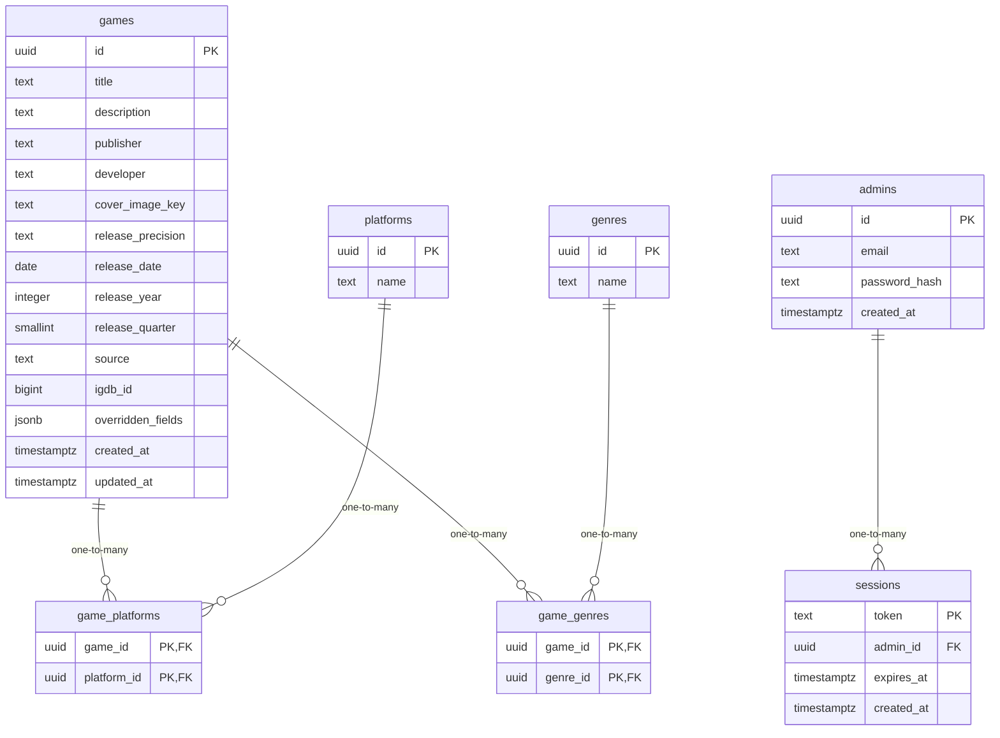

# Data Model

<!-- sdlc:auto:start entities -->
### games

| Field | Type | PK | FK | Nullable |
|---|---|---|---|---|
| id | uuid | True | — | False |
| title | text | False | — | False |
| description | text | False | — | True |
| publisher | text | False | — | True |
| developer | text | False | — | True |
| cover_image_key | text | False | — | True |
| release_precision | text | False | — | False |
| release_date | date | False | — | True |
| release_year | integer | False | — | True |
| release_quarter | smallint | False | — | True |
| source | text | False | — | False |
| igdb_id | bigint | False | — | True |
| overridden_fields | jsonb | False | — | False |
| created_at | timestamptz | False | — | False |
| updated_at | timestamptz | False | — | False |

### platforms

| Field | Type | PK | FK | Nullable |
|---|---|---|---|---|
| id | uuid | True | — | False |
| name | text | False | — | False |

### genres

| Field | Type | PK | FK | Nullable |
|---|---|---|---|---|
| id | uuid | True | — | False |
| name | text | False | — | False |

### game_platforms

| Field | Type | PK | FK | Nullable |
|---|---|---|---|---|
| game_id | uuid | True | games.id | False |
| platform_id | uuid | True | platforms.id | False |

### game_genres

| Field | Type | PK | FK | Nullable |
|---|---|---|---|---|
| game_id | uuid | True | games.id | False |
| genre_id | uuid | True | genres.id | False |

### admins

| Field | Type | PK | FK | Nullable |
|---|---|---|---|---|
| id | uuid | True | — | False |
| email | text | False | — | False |
| password_hash | text | False | — | False |
| created_at | timestamptz | False | — | False |

### sessions

| Field | Type | PK | FK | Nullable |
|---|---|---|---|---|
| token | text | True | — | False |
| admin_id | uuid | False | admins.id | False |
| expires_at | timestamptz | False | — | False |
| created_at | timestamptz | False | — | False |
<!-- sdlc:auto:end entities -->

<!-- sdlc:auto:start relationships -->
| Source | Target | Type |
|---|---|---|
| games | game_platforms | one-to-many |
| platforms | game_platforms | one-to-many |
| games | game_genres | one-to-many |
| genres | game_genres | one-to-many |
| admins | sessions | one-to-many |
<!-- sdlc:auto:end relationships -->

<!-- sdlc:auto:start er-diagram -->

<!-- sdlc:auto:end er-diagram -->
