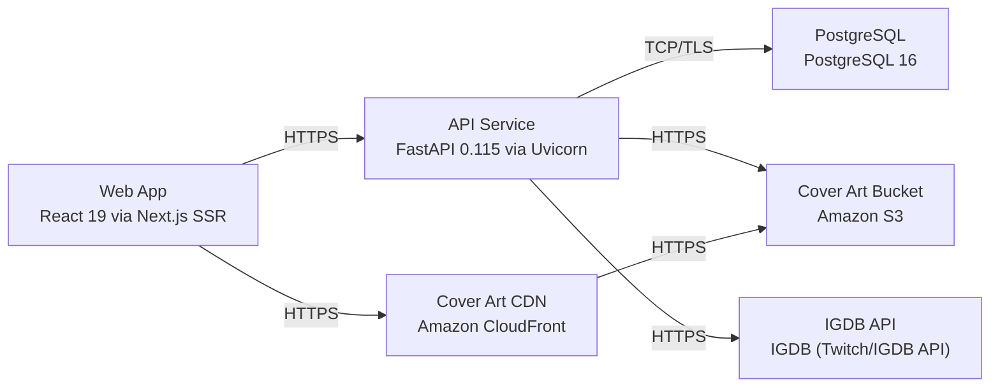

# Deployment Guide

> Maintained by QuorQ AI SDLC. Text between `sdlc:auto` markers is regenerated; anything outside them is yours and is kept.

<!-- sdlc:auto:start how-it-deploys -->
Pushes to `main` run `.github/workflows/deploy.yml`, which builds the API image (if there is a backend) and deploys the SPA to AWS Amplify. Commits touching only `docs/sdlc/**` don't deploy. Deployments can also be started from the platform's Deployment tab.
<!-- sdlc:auto:end how-it-deploys -->

<!-- sdlc:auto:start environments -->
| Name | Service | Runtime | Scaling | Environment |
|---|---|---|---|---|
| Web App | React 19 via Next.js SSR | Node.js | single small instance, modest scale | dev |
| API Service | FastAPI 0.115 via Uvicorn | Python 3.12 | single small instance | dev |
| PostgreSQL | PostgreSQL 16 | Amazon RDS for PostgreSQL | single instance | dev |
| Cover Art Bucket | Amazon S3 | S3 | managed | dev |
| Cover Art CDN | Amazon CloudFront | CloudFront | managed edge | dev |
| IGDB API | IGDB (Twitch/IGDB API) | external SaaS | external | dev |
<!-- sdlc:auto:end environments -->

<!-- sdlc:auto:start live -->
_Not deployed yet._
<!-- sdlc:auto:end live -->

<!-- sdlc:auto:start topology -->

<!-- sdlc:auto:end topology -->
